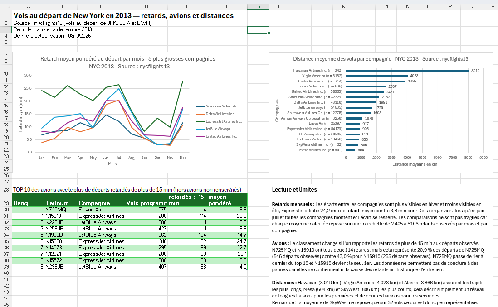
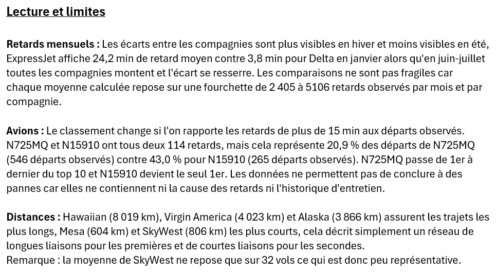

# Retards des vols au départ de New York

Préparation et agrégation de 336 776 vols au départ de New York en 2013 (jeu de données nycflights13), avec des contrôles de cohérence automatiques à chaque étape, puis restitution des retards dans un tableau de bord.

Projet réalisé dans le cadre de l'UE « Données : manipulation et visualisation » du M1 Data Science (Aix-Marseille Université, 2026).

## Objectif

Produire une table agrégée **mois × compagnie × avion × destination**, sans perte ni duplication de vols, qui permette d'analyser les retards au départ : nombre de vols, vols effectivement partis, retards observés, vols retardés de plus de 15 minutes, retard moyen et distance moyenne.

## Démarche

1. **Jointure** des vols avec la table des compagnies (`carrier` → `carrier_name`), en jointure gauche validée `many_to_one` : le nombre de vols est vérifié avant et après la jointure.
2. **Valeurs manquantes** : les 2 512 vols sans immatriculation d'avion (`tailnum`) sont conservés dans un groupe explicite `NON_RENSEIGNE`, plutôt que supprimés.
3. **Agrégation** par mois, compagnie, avion et destination, en distinguant les effectifs (vols programmés, partis, observés) pour que chaque moyenne repose sur le bon dénominateur.
4. **Contrôles**, appliqués à la table en mémoire puis au fichier exporté et relu :
   - colonnes présentes et dans l'ordre attendu ;
   - clé `month + carrier + tailnum + dest` complète et unique ;
   - nom de compagnie renseigné partout ;
   - effectifs entiers et positifs ;
   - cohérence des effectifs entre eux (retardés ≤ observés ≤ partis ≤ programmés) ;
   - réconciliation des totaux avec la table au grain « vol ».

## Résultats

Le tableau de bord présente :

- le **retard moyen pondéré par mois** pour les cinq plus grosses compagnies ;
- la **distance moyenne des vols par compagnie** ;
- les **dix avions** avec le plus de départs retardés de plus de 15 minutes ;
- une section **« Lecture et limites »**, qui discute la représentativité des moyennes (par exemple, la moyenne d'une compagnie ne reposant que sur 32 vols est peu fiable) et ce que les données ne permettent pas de conclure.






## Lancer le script

```
pip install pandas
python src/mini_projet_agregation.py
```

Le script attend :

- `data/derived/flights_analyse.csv` : la table des vols après les étapes de nettoyage réalisées en amont, au cours de l'UE (non incluses dans ce dépôt) ;
- `data/raw/airlines.csv` : la table des compagnies (séparateur `;`).

Il produit `data/derived/vols_mois_compagnie_avion_destination.csv`.

Les données ne sont pas versionnées. Elles proviennent du jeu public **nycflights13** (vols au départ des aéroports JFK, LGA et EWR en 2013).

## Fichiers

| Fichier | Contenu |
|---|---|
| `src/mini_projet_agregation.py` | Jointure, agrégation, contrôles et export |
| `images/` | Captures du tableau de bord Excel |

## Auteur

Badr Chqaf, M1 Data Science, Aix-Marseille Université
